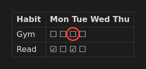
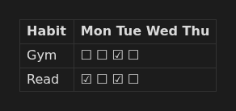

# Tickbox

Click or tap ☐ / ☑ boxes in Markdown table cells to tick them. Works on desktop and mobile.

| Before | After one click |
| ------ | --------------- |
|  |  |

The boxes are plain characters (☐ U+2610 and ☑ U+2611), so a note reads fine anywhere, even without the plugin.
Tickbox only adds the interaction.

## How to use it

- **Click or tap** a ☐ or ☑ in a table cell to flip it. Works in Live Preview and Reading view.
- **Ctrl+Z** (Cmd+Z on macOS) takes the last flip back.
- **Type `[]`** inside a table cell and it becomes ☐.
- **Toggle box in current cell** flips the box nearest the cursor while you edit a cell. Default hotkey:
  Ctrl/Cmd+Shift+Enter. You can change it in **Settings → Hotkeys**.

```markdown
| Habit | Mon Tue Wed |
| ----- | ----------- |
| Gym   | ☑ ☐ ☐       |
```

A cell can hold several boxes, mixed with text; each box toggles on its own. Tables inside callouts work too.

If what is on screen and the note's text don't match (for example a box inside a `%%comment%%`), Tickbox changes
nothing.

## Install

From Obsidian: **Settings → Community plugins → Browse**, search for **Tickbox**, then install and enable it.

By hand: download `main.js`, `manifest.json` and `styles.css` from the
[latest release](https://github.com/ArnarValur/obsidian-tickbox/releases/latest) into
`<vault>/.obsidian/plugins/tickbox/`, then enable **Tickbox** in **Settings → Community plugins**.

Reload Obsidian once after the first install so the hotkey becomes active.

## Privacy

Tickbox makes no network requests and collects nothing. It only edits the note you click in.

## Develop

```bash
npm install
npm run build        # main.js
npm run lint
npm test             # unit tests
npm run e2e          # real Obsidian (Flatpak on Linux), headless and isolated from your own Obsidian
```

- How it works: [docs/ARCHITECTURE.md](docs/ARCHITECTURE.md)
- What to check after an Obsidian update: [docs/obsidian-update-check.md](docs/obsidian-update-check.md)

## License

[MIT](LICENSE) © Merkurial-Studio - Arnar Valur
