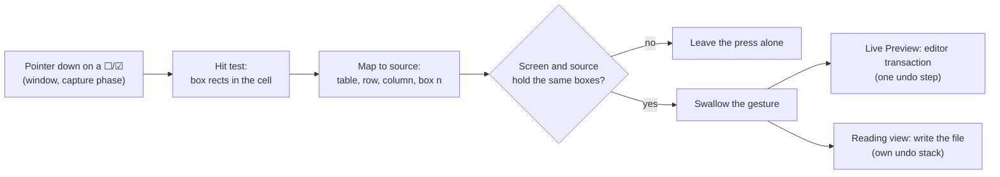

# Tickbox — how it works

## Modules

| File | Job |
|---|---|
| `src/table.ts` | Pure: split rows into cells (GFM, `\|` escapes, `>` prefixes), find tables, map a rendered box to its source spot (`resolveBox`), quick-insert rules. Unit-tested. |
| `src/click.ts` | Capture-phase pointer/mouse/touch listeners on every window; hit test; mapping per view; applying. |
| `src/editor.ts` | CodeMirror side: `toggleAt` (isolated history step), the undo tracker, the `[]` → ☐ view plugin. |
| `src/file-edit.ts` | Reading-view writes via `vault.process`, with a per-note undo/redo stack. |
| `src/strike.ts` | Strike boxes: adds `tickbox-struck` to the struck cells (or every cell of the row) of rendered tables. Reading view via the post processor; Live Preview via a `MutationObserver` on the editor (tables are widgets that Obsidian re-renders on its own). The rule itself is `strikeOf` in `src/table.ts`. |
| `src/main.ts` | Lifecycle: post processor, editor extensions, listeners (incl. pop-out windows), command, Ctrl+Z without editor focus. |

## Box kinds

| Kind | Open | Ticked | Typed as | Effect when ticked |
|---|---|---|---|---|
| Check | ☐ U+2610 | ☑ U+2611 | `[]` | none |
| Strike | ⊟ U+229F | ☒ U+2612 | `[-]` | strikes its cell's text; the whole row when the box is alone in its cell |

A box only ever flips within its own pair. The strike is CSS only; the source is never rewritten with `~~`.

## Why it works in Live Preview

Obsidian's table editor takes clicks on `mousedown`/`pointerdown` inside `.cm-table-widget`. Tickbox listens on the
**window in the capture phase**, so it runs first. When the press is on a box (and only then) it stops the pointer,
mouse, touch and click events of that gesture, so the table editor never opens the cell, and toggles on release.

## Mapping a box on screen to the source

- **Live Preview:** the table widget's DOM start (`EditorView.posAtDOM`) gives the header line. Row = `tr.rowIndex`
  (0 = header; body rows skip the delimiter line), column = `cellIndex`, box = its number among the boxes in the
  visible part of the cell. Tables inside callouts: the callout widget's start, then the n-th table in that quote block.
- **Cell being edited:** the cell has its own small CodeMirror editor; the box is changed there directly.
- **Reading view:** a markdown post processor remembers each rendered table's section; `getSectionInfo` gives its lines.
- **Safety check:** the source cell must hold exactly the boxes seen on screen, in order (e.g. `☐☑`). Otherwise
  nothing changes and the click goes through as normal. Covers boxes hidden in `%%comments%%`, stale renders, embeds.

## Findings about Obsidian 1.15 (probed in a real, headless instance)

- **LP table DOM:** `div.cm-embed-block.cm-table-widget > div.table-wrapper > table.table-editor`; each cell holds
  `div.table-cell-wrapper` (rendered). While a cell is edited, that wrapper is hidden and a second wrapper holds a
  nested `.cm-editor` with just the cell's text. Opening a cell editor re-pads the whole table's columns.
- **Reading view:** the note's hidden editor is alive, but an edit made through it is **not saved** (the view saves
  its preview data). So Reading view writes the file with `vault.process`.
- **Auto-pair:** typing `[` inserts `[]`; typing `]` then only moves the cursor past `]` (a selection change with no
  user event). Quick insert handles that, and needs a real `]` key/text input within 500 ms (so cursor moves can't trigger it).
- **Ctrl+Z in Reading view** does nothing in Obsidian itself; Tickbox adds it for its own toggles.
- **Default hotkeys** of a plugin switched on mid-session only start working after the app reloads.
- **First open of a vault with plugins** shows a "Do you trust the author of this vault?" dialog that covers the window.
- Registered editor extensions also run in the nested table-cell editors.

## Testing

- `npm test` — unit tests for `src/table.ts`.
- `npm run e2e` — starts the Flatpak Obsidian headless with its own profile and runtime dir (never the running one,
  never your own vault), test vault in `~/tickbox-test/e2e/`, real mouse clicks and CDP touch taps at the boxes' screen
  positions, checks editor text and the file on disk against an independent expectation. Screens and
  `report.json` in `.local/e2e/`. Includes a phone-layout pass (`app.emulateMobile(true)`).
